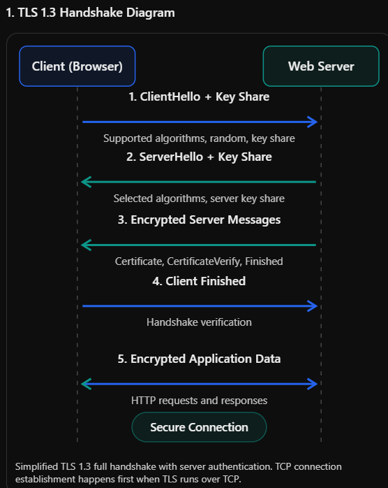
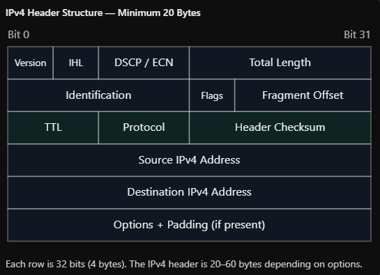
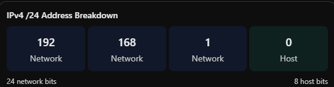
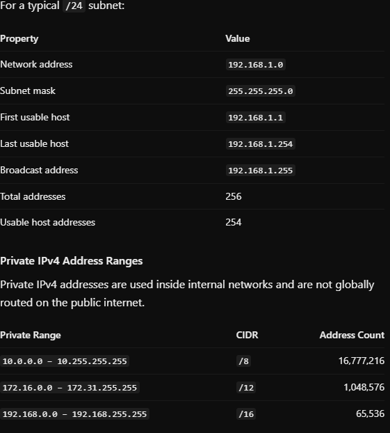
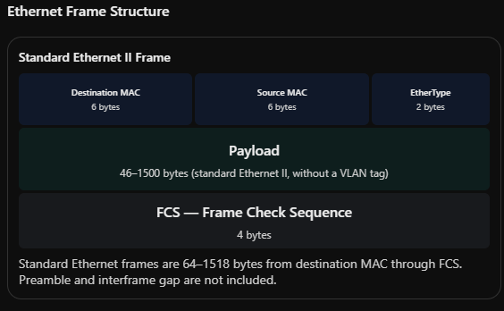
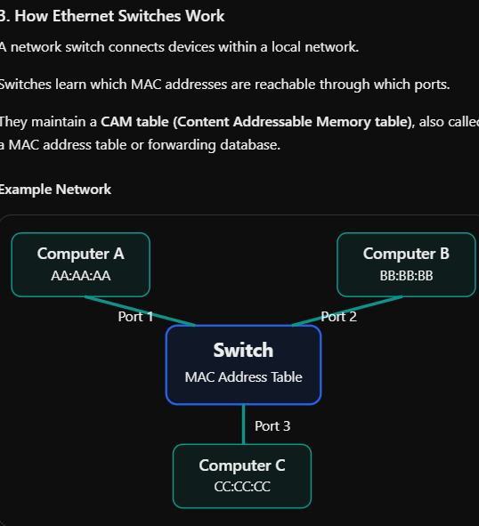
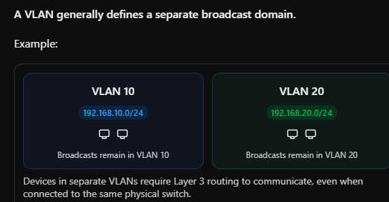

# OSI-MODEL

## Overview

The OSI model splits network comms into 7 layers. Each layer add its on header on the send host, and removes it on the receiving host. Each layers talks to its peewr on the otherside and treats teh layer belowe as a service

Layers

- 7 Application
  - App Level Protocol 
  - HTTPS
    - A request lin (method, path, version), headers, and an optional body. Responses carry a status code (2xx-5xx)
    - Attacks:
      - SQLi, XSS,CSRF, SSRF, dir traversal, request smuggling
  - DNS
    - Records A, AAAA, MX, NS CNAME, PTR
      - A: Address which maps domain to IPv4 
        - example.com -> 93.184.214.14
      - AAAA (IPv6 Address): Maps a domain to an IPv6 address
        - example.com -> 2001:db8::1
      - MX: Identifies mail servers responsible for receiving email
        - example.com -> mail.example.com
      - NS: Name Server - Identifies authoritative DNS servers for a domain
        - example.com -> ns1.example.com
      - CNAME: Conanonical Name
        - Create an alias pointing to another domain name
          - welcome.com -> example.com
      - PTR: Pointer - MAps an ip address back to a hostname (reverse DNS)
        - 192.0.2.10 -> server.example.com
    - DHCP
      - Dynamic HOst Configuration Protocol automatically assigns IP addresses and other netwok configuration settings to devices when they connect to a network
      - PORTS
        - UPD 67 DHCP Server - Receives request from DHCP clients
        - UDP 68 DHCP Client - Receives responses from DHCP server
        - DORA Proces
          - D - Discover 
            - Client initiated: "Who can offer me an IP
          - O - Offer
            - Server init: "I can offer 192.168.1.100:
          - R - Request
            - Client  init: I request that ip
          - A - Acknowledgement (ACK)
            - Server: "Lease confirmed
      - DCHP Security Risks
        - DHCP Starvation (DoS)
          - Flood the servers with request to exhaust available leases
        - Rogue DHCP Server (Interception)
          - Unauthorized DHCP server provides to client
        - Sppofing (Man in the middle attack)
          - Impersonate legitimate server and provide malicous settings
        - Malicious DNS assignment
          - Send over attacker supplied dns server
        - Mailcious gatewayt
          - send over attacker controlled gateway
      - Mail, and Shell
        - SMTP, IMAP POP3, SSH(22) 
          - SSH
            - Client establishes connection to port 22
            - Client and server neggotiate ssh protocol params, and crypto algos
            - Perform key exchange
            - client verifies the server host key
            - Server auths the user, with an SSH key or passwords
            - Users receives session and starts
            - ATTacks:
              - Bruteforce
              - Credential stuffing
              - SSH key theft
              - Man in the middle - impersonate netowrk or server
              - Vulnerable SSH software (supply chain attacks)
- 6 (presentation) and 5 (session):
  - TLS (Transport LAyer security) handshake:
    
    1. Client Hello
       1. The client initiates the TLS hadnshake by sending ClientHello
          1. Supported TLS Version
          2. Supported Cipher Suites
          3. A cllient-generated random value
          4. support cyrpto groups 
          5. a public key share for agreement
    2. Server Hellow
       1. The server response
          1. The selected TLS version
          2. The selected cipher suite
          3. a server generated random value
          4. the server public key
    3. Shared Key Derivation
       1. The client and server use their private keys and exchanged public key to independently calculate a shared secret. TLS 1.3 commonly useed ECDHE (elliptic curve diffie hellma ephemeral)
       2. The shared secret is process through a key derivation function to create symmetric encryption keys
    4. Server authentication
       1. After server hellom the server sends encrypted handshaake message
          1. Inlcudes:
             1. EncryptedExtensions
             2. Certificate
             3. CertificateVerify
             4. Finised
       2. The client validates the cert
          1. The cer is valid for the requested hostname
          2. The cert is not expired
          3. The cert chains to a tructed certificate authority (CA)
          4. The cert signatures are valide
          5. Revocation status is acceptable under the clients validation policy
       3. Certificatevery messages prove the server possesses the private key associated iwth its certificate
       4. CLient Finished gets sent to server
       5. Note: Standard https usually authenticates the server, not the client. Mutual TLS (mTLS) Additionally requires the client to present a certificate and proves possesion of its private key
       6. Then the client and server can now exchange application data using the symmetric encryption
          1. AES-125GCM, AES-256-GCM, etc
  - Session station: cookies,s bearer tokesn, TLS session
  - Attacks:
    - SSL Stripping, 
    - Downgrade attacks, 
    - Rogue CA
    - Stolen tokes (session replay)

- 4 Transport:
  - TCP: Transmission control protocol is connection-oriented
    - Connection oriented: Estbalishes connection useing a 3-way handshake (SYN->SYN-ACK-ACK)
    - Reliable delivery: Detects lost data, and retransmits it when necessary
    - ORderede Delivery: Ensures data is delivered in correct order
    - Error detection: Uses checksums to detect corruption
    - Flow control: Prevents sender from overwhelming receiver
    - Common TCP Ports
      -  22:SSH
      -  80:HTTP
      -  443: HTTPs
      -  25: SMTP
      -  3389: RDP
      -  445: SMB (file and printer)
  - UDP:
    - User datagram protocol
    - Allows devices to send data across a network without first estbalishing a connection
    - Prioritizes speed, low everhead, and low latencty over gauranteed delivery
    - Process
      - Cliend send a UDP datagram containing DNS query
      - DNS server receives query
      - Server send UDP response
      - Client receives the response
      - No gurantee on query or response arrival, but retries can occur (not from udp but from the server or client themselves)
      - Common uses and ports
        - DNS, GAming, VoIP, DHCP, streaming
        - 53:DNS
        - 67: DHCP server
        - 68 DHCP client
        - 69: TFTP
        - 123: nTP
        - 161 SNMP
        - 162: SNMP Trap
        - 500: IKE
        - 514: Syslog
        - 443: HTTP/3 (QUIC - An ecnrypted overlay on udp)
      - Common attacks
        - UDP Floods
        - UDP SPoofing - send packets with forged source ip address
        - DNS applicfication - Attakcer spoofs victim ip -> sends DNS query -> DNS resolver sends response to real ip (amplify this and you overwhelm the real ip)
        - UDP port scans
- 3 Network
  - Moves packets between different networks using logical ip addressing and routing
  - Addressing:
    - Ipv4 (32-bit), IPv6 (128-bits)
  - Primary protocols Ipv4, ipv6, ICMP, ICMPv6
  - Devices: Routers, layer 3 switches, firewalls
  - Ipv4 Header Fields
    - Every ipv4 packet contains a header that tells network devices where the packet is going, how its handled, and the protocol
    - 
  - Roouting
    - Routers use routing tables to determine where to forward packets using longest prefix match
  - IP Addressing and CIDR
    - CIDR: Classless inter-domain routing
      - CIDR notation indicates how many bits of an ip address represnt the network
      - 192.168.1.0/24
        - 32 bits
        - /24 bits is the network
        - remaining 8 bits to identify addresses in the network 
        - 
        - 
- 2 Data link
  - Ethernet, mac addresses, switching, vlans, arps
  - Purpose is local frame delivery and media access
  - 
  - MAC Addresses
    - Media access control (48 bits)
    - Not secure, it can be spoofed easily
    - 
    - 
- 1 Physical
  - Signals, cables, fiber, wireless, radio waves
  - Bandwidth is the amount of adadta link can transmit per second (bits/sec)
  - Latency is how long it takes for the data to travel

# Lab

Layer 7 : The application builds the request
Predict: The browser wants a web page. What does layer 7 produce
1. It starts by producing the process to find where to resolve the request
2. So it looks for ip in browser cache-> system os -> then must go outside of device so it it must request from the local network wich may have its own cache( of course this in itself will kick off layer 4 dns request) -> if local network doesn't know it, but go towards teh lan gateway which will ask it's dns server (the dns server will hold the request and go on its own journey where it will check its on cache then the the nameservser that hold the ip. Once found it will all unwiind to back tor respond to the computer and browswer which will then produce https or http requests to the servers). And of course all of this includes all the layers below 7

Just the HTTP request text. Layer 7 has no idea about addresses; it hands plain bytes to the layer below.

Protocol
HTTP/1.1
Data
GET /index.html
Security lens: SQL injection, XSS, and broken auth live here. A WAF inspects this layer.

Layer 6: TLS encrypts the payload

Predict: Where does encryption sit, and what does the payload look like afterward?